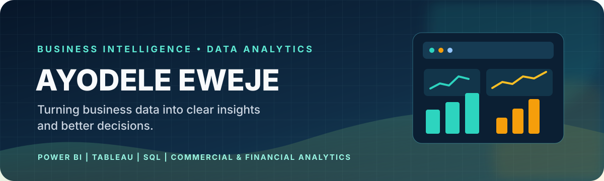

<!-- PROFILE HERO -->

  

  
  
  

<h1 align="center">Hi, I'm Ayodele Eweje 👋</h1>
<h3 align="center">Business Intelligence & Data Analytics | Power BI • Tableau • SQL</h3>

  <em>Turning business data into clear insights, stronger performance and better decisions.</em>

---

## 👨🏽‍💻 About Me

I am a Business Intelligence and Data Analytics professional with **8+ years of experience** spanning corporate strategy, commercial analytics, financial analysis, sales planning, management reporting and process improvement.

I work at the intersection of **data, technology and business performance** — transforming operational and financial information into dashboards, meaningful analysis and practical recommendations. My experience covers financial services, travel, automotive and technology-enabled business operations.

- 📊 Build executive dashboards and KPI reports that make performance easier to understand.
- 💹 Analyse revenue, cost, profitability, pricing, margins and sales performance.
- 🧭 Translate business questions into structured analysis and actionable insights.
- ⚙️ Improve reporting processes, data quality, workflows and SOP governance.
- 🤝 Partner with Finance, Operations, Commercial teams and business leadership.
- 🌍 Open to collaboration and opportunities in Business Intelligence and Data Analytics.

## 🧰 Technology & Skills

**Business Intelligence & Visualisation**

**Data & Databases**

| Analytics | Business & Process |
|---|---|
| Dashboard development & KPI reporting | Commercial and financial performance |
| Data analysis & trend identification | Pricing, margin and revenue analysis |
| SQL querying & data preparation | Revenue forecasting and scenario modelling |
| Sales and product performance analysis | Process improvement and SOP governance |
| Market and competitor intelligence | Reporting automation and data quality |

## 💼 Professional Experience

<strong>Head of Business Intelligence & Process Team — Club Concierge International (CCI & GoTravelCC)</strong> · Nov 2025 – Present

- Lead Business Intelligence, commercial analysis and process governance initiatives.
- Develop pricing models and conduct margin analysis to support service-line profitability.
- Partner with Finance on revenue forecasting and financial scenario modelling.
- Deliver executive dashboards and commercial performance reviews.
- Develop SOP frameworks and standardise cross-functional workflows.
- Identify automation opportunities and conduct process audits to improve efficiency.
- Lead and coordinate a team of eight direct reports.

<strong>Corporate Strategy & Business Analytics Officer — Hope Payment Services Bank</strong> · Jan 2024 – Oct 2025

- Supported corporate strategy and business analytics, reporting directly to the MD/CEO.
- Prepared Board papers and executive reports using balance-sheet and financial performance analysis.
- Designed dashboards to monitor strategic KPIs and organisational performance.
- Automated GL and Mirror GL reconciliation processes, reducing manual errors by 30%.
- Supported strategic goal cascading, market research and data-driven business initiatives.

<strong>Data Analysis & Sales Planning — Stallion Group (Stallion Bajaj)</strong> · Oct 2020 – Dec 2023

- Led the Sales MIS function across Nigeria.
- Produced sales trend analytics, executive dashboards and product performance reviews.
- Conducted competitor market-share analysis and coordinated market surveys.
- Built a retail tracking system to improve visibility into end-customer demand.

<strong>Data Analyst / MIS Executive – Network Expansion — Simba Group</strong> · Apr 2018 – Oct 2020

- Conducted ROI, dealer growth and competitive intelligence analysis.
- Developed expansion feasibility reports and executive presentations.
- Standardised reporting frameworks for field executives.

<strong>Team Member – IT Business Interface Office — UBA Plc</strong> · Jul 2016 – Mar 2018

- Managed database queries using Toad for Oracle and MySQL.
- Developed operational reports for IT incident tracking.
- Supported enterprise IT operations, user administration and UAT testing.

## 🚀 Featured Portfolio Project

An executive-style portfolio project demonstrating revenue, cost, gross profit, margin, sales volume and year-on-year performance analysis. Includes a **synthetic demonstration dataset**, DAX measures, report theme and build guide.

➡️ **[Explore the dashboard project](business-performance-dashboard/)**

## 🎓 Education

- **MSc Information Management** — Ahmadu Bello University, Zaria *(In view)*
- **BSc Computer Science, Second Class Honours (Upper Division)** — Ajayi Crowther University, 2021
- **HND Computer Science, Lower Credit** — Lagos State Polytechnic, 2014
- **ND Computer Science, Upper Credit** — Lagos State Polytechnic, 2011

## 📜 Professional Training & Certifications

- ChatGPT for Data Analytics — Mavin Analytics, 2024
- Excel, Power BI, Tableau, PostgreSQL, Microsoft SQL Server and Problem-Solving Skills — Quantum Analytics, 2023
- Ask Questions to Make Data-Driven Decisions — Google / Coursera, 2022
- Google Foundations: Data, Data, Everywhere — Google / Coursera, 2022
- Banking Operation — FITC, 2017

## 📈 GitHub at a Glance

  
  

  

## 🤝 Let's Connect

I welcome conversations around Business Intelligence, data analytics, commercial performance, reporting and process improvement.

- 📧 **Email:** [heyweyjey4you@gmail.com](mailto:heyweyjey4you@gmail.com)
- 💼 **LinkedIn:** [Ayodele Eweje](https://www.linkedin.com/in/eweje-oyewole-ayodele-3a99668a)
- 💻 **GitHub:** [@Ayodele-Eweje](https://github.com/Ayodele-Eweje)

---

  <strong>“Good data tells a story. Great analysis helps people decide what to do next.”</strong>
    
  Thanks for visiting my profile. Feel free to explore my projects and connect.

